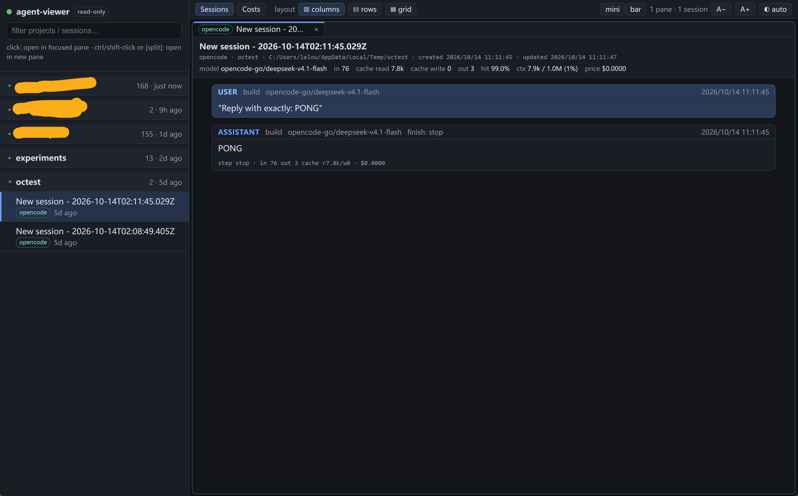
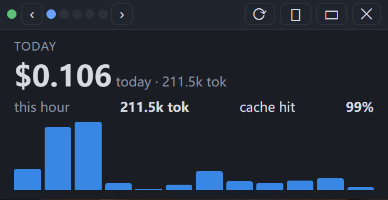
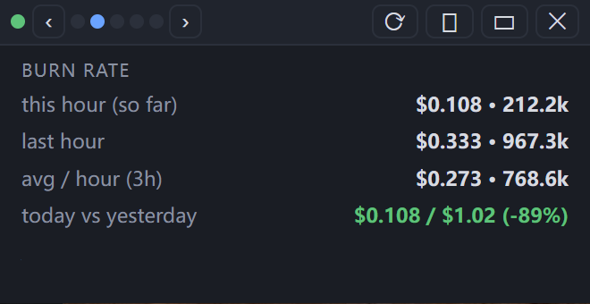
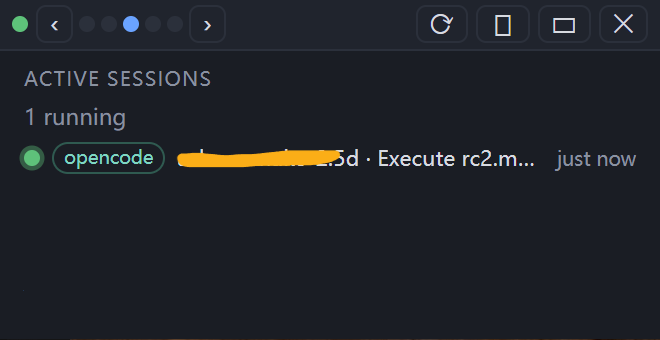
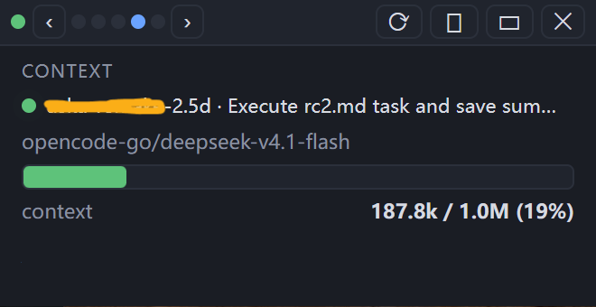
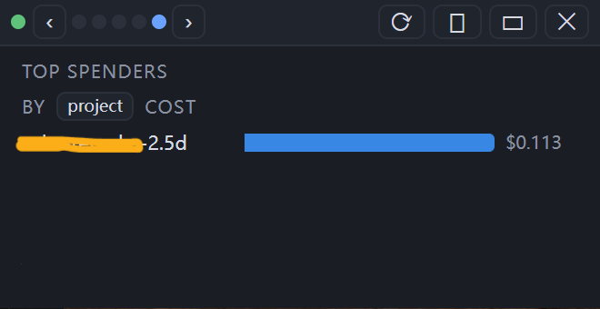
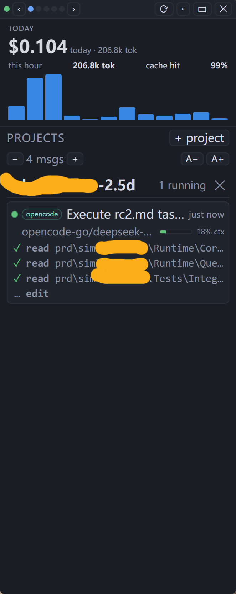
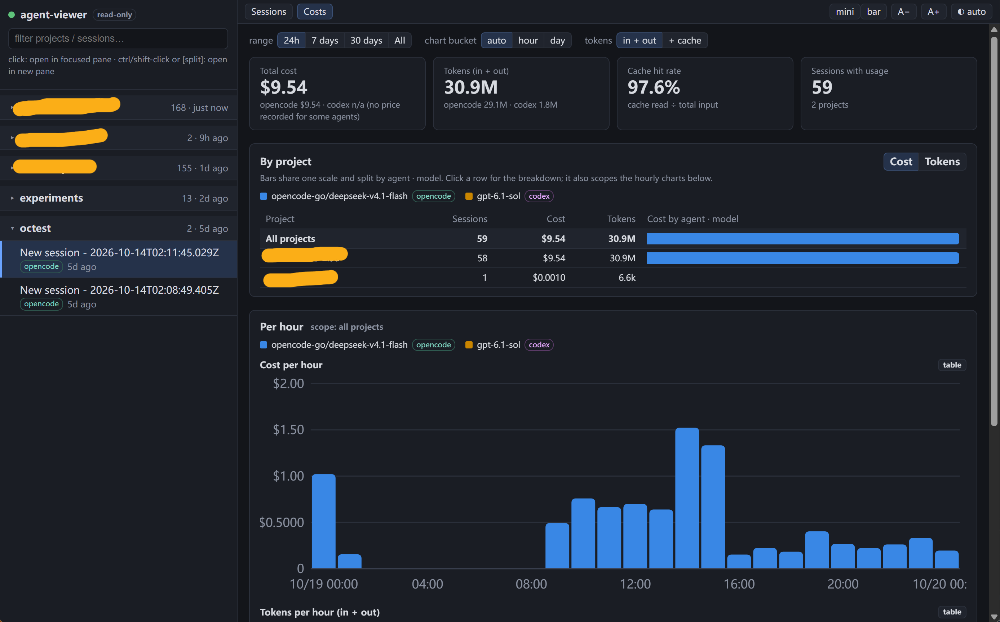

# agent-viewer

Read-only, realtime web viewer for coding-agent session history. Sessions are grouped by
project and sorted by last modified. Multiple sessions can be watched at once in split
panes / tabs.

Supported: **opencode** (`opencode.db`, SQLite) and **codex** (`~/.codex/sessions/**/rollout-*.jsonl`).



```
make linux      # dist/agent-viewer-linux        (Linux / WSL)
make windows    # dist/agent-viewer-windows.exe  (Windows, console)
make windows-gui # dist/agent-viewer-gui.exe      (Windows, no console, opens the window)
make all        # all three
./dist/agent-viewer-linux  # http://127.0.0.1:9191
```

## Detection
Each build looks only at its own user home: the WSL/Linux build at `~`, the Windows build at
`%USERPROFILE%`. Run the matching build on each side.

- opencode: `$XDG_DATA_HOME/opencode` or `~/.local/share/opencode`
- codex: `$CODEX_HOME` or `~/.codex`
- extra: `-dir <path>` (repeatable; opencode.db / opencode data dir / codex home)

## Read-only
opencode DB is opened with `mode=ro` + `query_only`; codex files are opened read-only and only
read forward. Nothing is ever written.

## Architecture
```
cmd/agent-viewer/     main: flags, wiring (-ldflags -X main.defaultGUI=1 selects the no-console GUI default)
internal/model/       the normalized contract (Session, Message, Part, Delta, Stats, UsageRow) + the Backend interface
internal/opencode/    Backend for opencode.db (SQLite): sessions, deltas, stats, hourly usage, running detection
internal/codex/       Backend for codex rollout JSONL files (same contract)
internal/detect/      finds the history on this machine (home dir, XDG, CODEX_HOME, -dir)
internal/server/      HTTP API (/api/projects, session, stats, usage, feed, SSE events) + static web UI
internal/gui/         embedded WebView2 window and window modes (Windows; a stub elsewhere)
web/                  browser UI, embedded into the binary: index.html, css/, js/ (app, cost, stats, bar)
```
Backends only produce the contract; the server and the frontend only consume it. Add an agent = one new
package under `internal/` implementing `model.Backend` + a case in `internal/detect`. `make test` runs vet and tests.

Realtime: the server polls file stats (db/wal mtime, rollout dir) once a second and pushes SSE
`change` events; the browser then fetches incremental deltas (opaque cursor per view).

## Limits
- Opening a Windows-side opencode DB from WSL (`/mnt/c`) falls back to `immutable` mode, which can't
  see the WAL; run the Windows build instead (hence no `/mnt/c` auto-detect).
- opencode session `mtime` = max(session.time_updated, newest message time_created).

## GUI window (Windows build)
`make windows-gui` builds `dist/agent-viewer-gui.exe`: no console window, opens the embedded window directly
(WebView2 via the pure-Go `go-webview2`, no cgo; needs the WebView2 runtime, preinstalled on Windows 11).
Logs go to `%LOCALAPPDATA%\agent-viewer\agent-viewer.log`; fatal errors show in a message box.
`agent-viewer-windows.exe -gui` does the same with a console. The server listens on `127.0.0.1:9181`
(random port if taken; `-addr` overrides) and closing the window exits the process. Settings persist in
`%LOCALAPPDATA%\agent-viewer\webview2` (hence the fixed default port: localStorage is per origin).

Three window modes, chosen with buttons only (minimize is a normal minimize); each mode remembers its own
size and position (`window.json`):
- **Full** - the normal window.
- **Mini** (`mini` button) - small borderless always-on-top window with switchable pages: Today, Burn rate,
  Active sessions, Context gauge, Top spenders. `‹ ›` or the dots switch pages, `⟳` toggles auto-rotate (8 s).
- **Bar** (`bar` button) - tall, borderless, always-on-top and resizable from every edge. The stats pages
  sit on top; below, `+ project` picks projects to follow, and each shows its active sessions (pulsing dot =
  running now, with model and context %) with the latest N messages (user prompts, assistant text, one-line
  tool calls; default 4, adjustable). New messages slide in, older ones fade out.

Mini pages (Today, Burn rate, Active sessions, Context, Top spenders):

<p>
  
  
  
  
  
</p>

Bar mode (stats on top, followed projects with their running sessions and latest messages):



*Running* (= active) is read from the last message: opencode - newest assistant message unfinished; codex - a started turn
without completion; and the history was touched in the last 10 min (a crashed agent leaves turns open). Only running
sessions are listed under a project; with none running, its latest session is shown dimmed. Drag a mode window by its header.
Mini and bar are also available in a browser at `#mini` / `#bar`. The Linux/WSL build has no embedded
window (would need cgo + WebKitGTK); use the browser.

## Costs page



`Costs` button (top bar, `#costs`): a range filter (24h / 7d / 30d / all), tiles (total cost, tokens,
cache hit rate, sessions), a **by-project table** with a stacked bar per row split by agent · model
(cost or tokens; click a row for the per-model breakdown, which also scopes the charts), and
**cost per hour / tokens per hour** stacked-column charts (hour or day buckets) with a table view.
Series colors are a validated 8-slot palette assigned by all-time volume, so filters never repaint them;
models beyond 8 fold into "Other models". Tokens = in + out by default (`+ cache` toggles cache read/write).
Backends implement `Usage()` (hourly rows per session+model); opencode updates it incrementally per
message, codex by file offset from `token_count` deltas. Codex has no price, so it appears in token
views only.

## Session header stats
model (first → latest), in (new, uncached input only; total input = in + cache read + cache write), cache read, cache write, out,
cache hit rate (cache read / total in), context length (prompt size of the latest request, plus
window and % when the agent records it), price. Backends fill `Stats` in `model.go`.
- opencode: session-row totals + recorded cost; context window comes from opencode's cached models.json catalog (shown without % if the model is not in it).
- codex: latest cumulative `token_count` + `model_context_window`; price is not recorded (`n/a`).

## TODO
- Claude Code support (a new `Backend` for `~/.claude/projects/**/*.jsonl`).
- Subagent jump for Claude Code (opencode is done: a `task` call has an `open ↗` button; codex: see issue #1).

## Releases
Pushing a tag `vX.Y.Z` runs `.github/workflows/release.yml`, which builds and attaches to a GitHub release:
`agent-viewer-linux-amd64.tar.gz` (web UI server), `agent-viewer-windows-amd64.zip` (console exe; web UI or `-gui`),
`agent-viewer-gui-windows-amd64.zip` (no-console window) and `SHA256SUMS`. There is no Linux GUI build.
